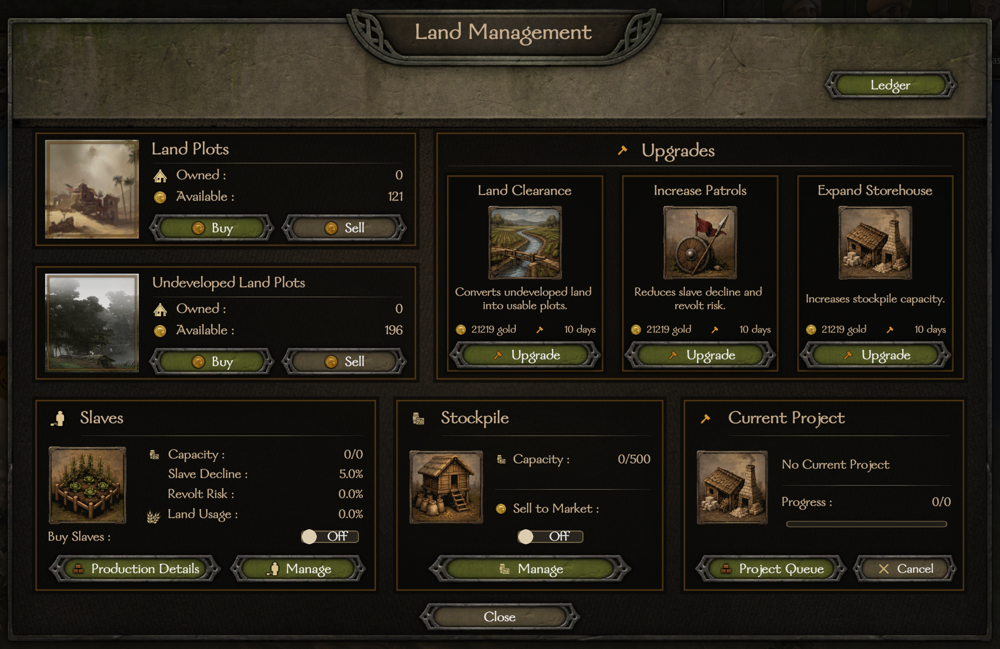
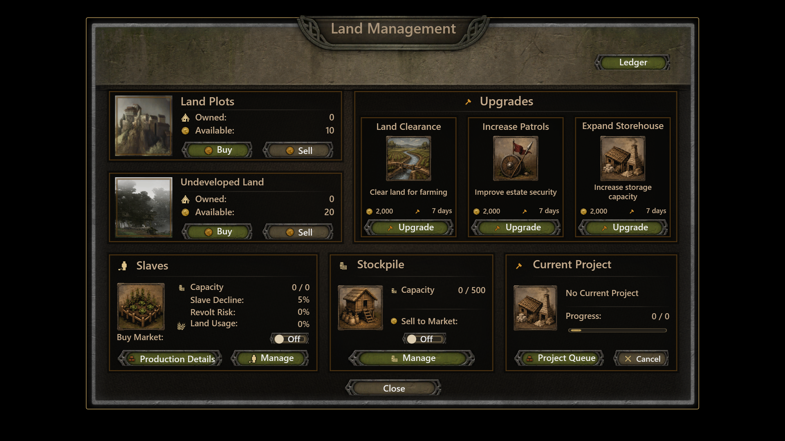
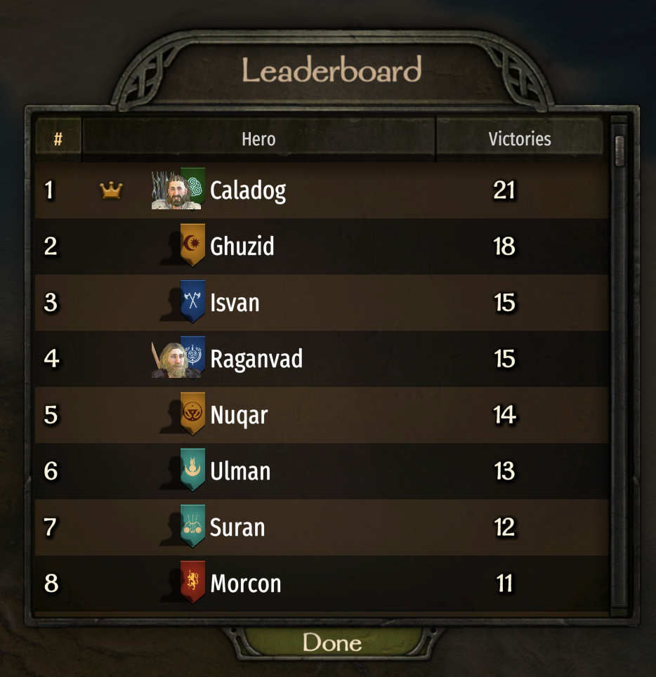
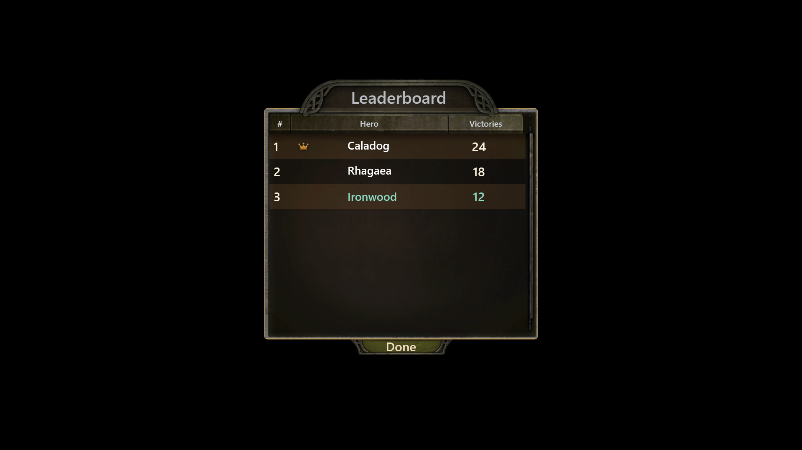
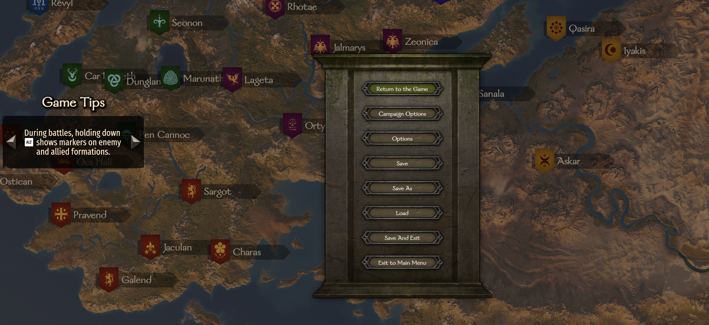
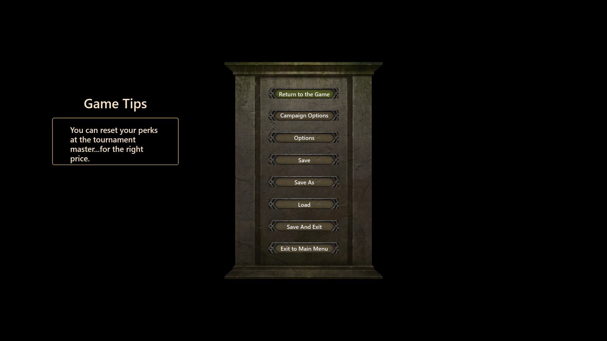

# Bannerlord.XmlPreview

Preview and inspect Mount & Blade II: Bannerlord Gauntlet XML prefabs without launching the game. Open a prefab, explore its widget tree, adjust preview data and resolution, and investigate layout, asset, binding, and reference issues.

## Preview examples

These comparisons show what to expect from the preview today. XML previews were captured at 1920 × 1080 using installed Bannerlord v1.4.7 assets and illustrative Preview Scenario data. The supplied in-game screenshots use different framing and resolutions. Live game backgrounds are replaced with black in the previews; text, values, fonts, and layout can also differ. These examples do not establish pixel-perfect fidelity.

| Screen | In game | XML preview |
| --- | --- | --- |
| **LandManagement** — Preview uses AgricultureEstate v1.4.7.3; estate panels, upgrade cards, icons, and controls. Settlement art, labels, and values differ. | [](docs/images/previews/land-management-ingame.png) | [](docs/images/previews/land-management.png) |
| **GameMenuTournamentLeaderboard** — Native; three sample entries, alternating rows, and player highlighting. Portraits and clan banners are absent; this preview is `Partial`. | [](docs/images/previews/tournament-leaderboard-ingame.png) | [](docs/images/previews/tournament-leaderboard.png) |
| **EscapeMenu** — Native; populated pause menu and game-tip panel. The preview uses a different tip, with tip navigation disabled, and omits the campaign map. | [](docs/images/previews/escape-menu-ingame.png) | [](docs/images/previews/escape-menu.png) |

Open either image at its original resolution. Text, values, and selections in the previews are sample data.

## Download and install

You need Windows x64 and a local Bannerlord installation for game assets. Game assets are not included. Validation currently covers Bannerlord v1.4.7, with AgricultureEstate v1.4.7.3 coverage; other versions may differ.

Download a ZIP from [GitHub Releases](https://github.com/DasNeo/Bannerlord.XmlPreview/releases):

| Package | Choose this when |
| --- | --- |
| `win-x64-self-contained.zip` | You want the included .NET desktop runtime. |
| `win-x64-framework-dependent.zip` | You already have the .NET 10 Desktop Runtime x64 installed and want a smaller download. |

Extract the entire ZIP to a folder and run `Bannerlord.XmlPreview.exe`. Each ZIP has a matching SHA-256 checksum file.

## Open your first preview

1. Start `Bannerlord.XmlPreview.exe`.
2. In the **Bannerlord** field, enter your game installation directory, or use **Browse**. Select **Apply**.
3. Select **Open Prefab** and choose a Gauntlet XML prefab from the game or a mod. For example, open `Modules\Native\GUI\Prefabs\Standard\Standard.Window.xml` inside your Bannerlord installation.
4. Explore the preview and widget tree to inspect layout and Diagnostics. Change the **Preview** width and height to check another resolution.

Assets load directly from installed module TPAC packages. Verified editable mod packages can use their RuntimeDataCache companion; manual DDS export is not required.

## Work on a prefab

Edit the XML in your preferred editor. The app watches loaded dependencies; use **Reload** to request a fresh preview. If loading fails, the **Last Good Preview** remains visible and is marked as stale. Check Diagnostics for the failure before relying on that view.

Use **Scenario** controls to create, save, clone, rename, or delete a Preview Scenario. A scenario preserves preview data, widget states, and resolution so you can return to the same setup. Bindings and list contents are editable in the app. Save changes before switching scenarios.

Scenarios are stored in `%LOCALAPPDATA%\Bannerlord.XmlPreview\Scenarios`. Use **Edit Scenario** to edit JSON for widget states, dynamic image masks, and reference capture settings. To enable editor navigation, set `BANNERLORD_PREVIEW_EDITOR` to an editor executable that accepts `--goto file:line:column`; otherwise source actions copy the location.

## Use mocks to populate a preview

Prefabs normally receive text, values, and lists from the game. Supply those values through **Bindings** and **Mocks** to preview different screen states without running a campaign.

- **Bindings** sets shared values such as a screen title, a counter, or a visibility flag. Use **Filter Bindings** to find a field by name or value.
- **Mocks** supplies entries for discovered template lists, such as leaderboard rows or menu buttons. Each entry has its own binding values.

1. Open a prefab and create or select a **Scenario** to save your setup.
2. Expand **Mocks**, find the list you want to populate, and click **Add**. Edit the entry's fields; use **Remove** to delete an entry. Remove all entries to check the empty-list layout.
3. Click outside an edited field to apply its value. The preview reloads automatically. Use `true` or `false` for boolean fields and numeric text for counts.
4. Click **Save** in the Scenario controls to keep both list entries and shared bindings. Save before switching scenarios.

For example, open `Modules\Native\GUI\Prefabs\GameMenu\GameMenuTournamentLeaderboard.xml` and add an entry with `@Name` = `Caladog`, `@RankText` = `1`, `@Victories` = `24`, and `@IsMainHero` = `false`. Add another entry with `@IsMainHero` = `true` to inspect player highlighting. Keep each entry's automatically assigned `@__key` unique.

These values affect the preview only; they do not read or change your saved game. Portraits and other runtime images need separate image inputs and may remain unavailable even when list text is populated.

## Compare with a reference

**Compare Reference** opens an image comparison for the current scenario, with reference, actual, side-by-side, overlay, and diff views. Shared zoom and pan help inspect differences. Its uncalibrated default does not certify in-game fidelity.

**Open Comparison Report** opens saved Visual Regression artifacts for the active saved scenario. A Full run includes pixel comparison; a Structure Only report records pixels as `NotRun` and has no image comparison views. See the [Visual Regression workflow](https://github.com/DasNeo/Bannerlord.XmlPreview/blob/main/test-data/visual-regression/README.md) for preparing reference packages and running comparisons.

## Understand preview limits

The preview helps investigate prefabs, but a successful structural check does not establish pixel-perfect agreement with the game. Check the [image fidelity matrix](docs/fidelity/images.md) for verified behavior and known limitations.

- Mod-specific executable Code Widgets appear as labeled placeholders. The app does not execute their code.
- Images that require live game state need explicit scenario data. Unavailable runtime content remains visibly `Partial`.
- Missing assets or references appear in Diagnostics. Confirm the installation path and relevant module assets when a preview is incomplete.

When reporting a problem, include the game and mod versions, prefab path, Preview Scenario, Diagnostics, and expected behavior. [Report an issue](https://github.com/DasNeo/Bannerlord.XmlPreview/issues).

## Command line

From the extracted application folder:

```powershell
.\Bannerlord.XmlPreview.exe `
  --bannerlord-root "C:\Program Files (x86)\Steam\steamapps\common\Mount & Blade II Bannerlord" `
  --prefab "C:\path\to\YourPrefab.xml"
```

| Argument | Purpose |
| --- | --- |
| `--bannerlord-root <path>` | Set the Bannerlord installation directory. |
| `--prefab <path>` | Load a prefab directly. |
| `--diagnostics-out <path>` | Write a Diagnostics snapshot. |
| `--exit-after-load` | Exit after the technical validation run. |

## Development

This project was developed with assistance from AI coding tools. The maintainer is responsible for the published code, testing, and releases.

For building, testing, architecture, and release instructions, see [Contributing](https://github.com/DasNeo/Bannerlord.XmlPreview/blob/main/CONTRIBUTING.md).

## License

Original project code and documentation are licensed under the [MIT License](LICENSE).
Third-party components, game and mod content, and screenshots containing that content are excluded from this grant and retain their respective rights and license terms. See [third-party notices](THIRD-PARTY-NOTICES.md).
